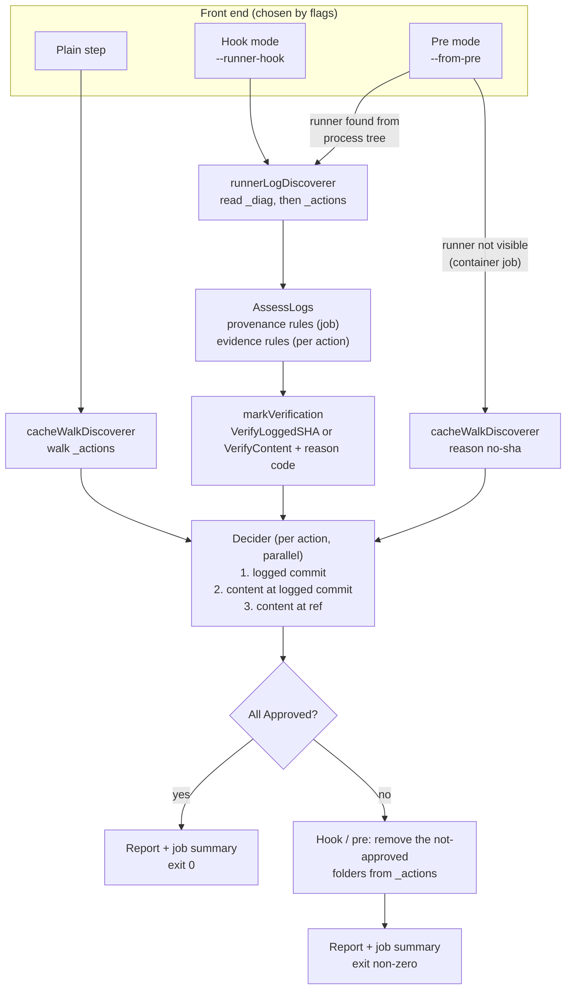
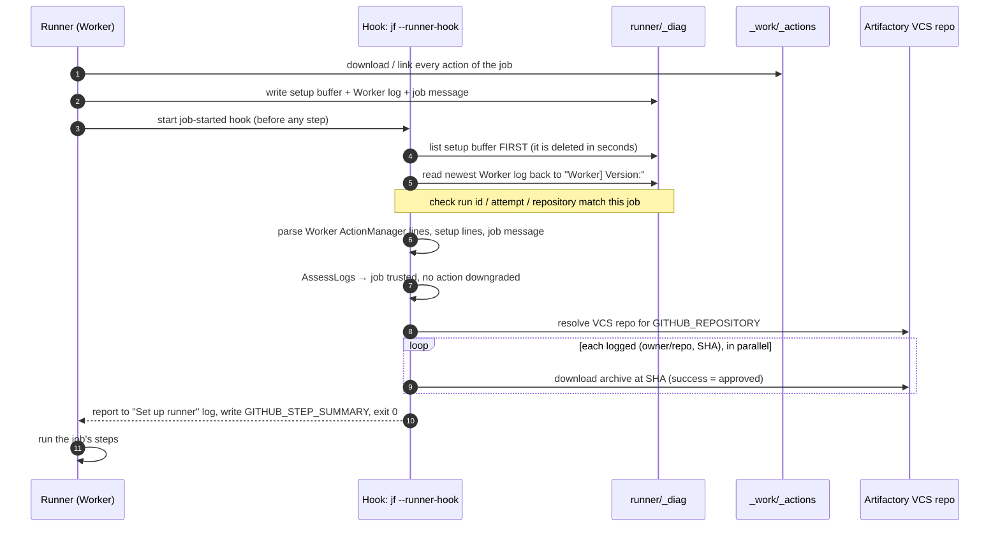
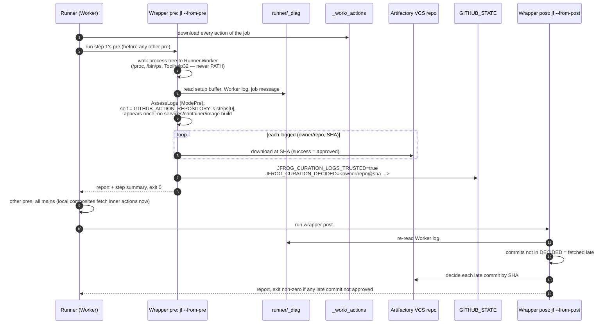

# `jf curate-gh-actions` — design

Status: implemented on `feature/XRAY-162044` (packages `commands/curation`, `commands/curation/githubactions`,
`commands/curation/runnerhook`, flag wiring in `cli/scancommands.go`).

## 1. Purpose

`jf curate-gh-actions` makes sure that every third-party GitHub Action a job is about to run has been approved by
JFrog Curation. Artifactory proxies GitHub through a VCS remote repository; a successful download of an action
through that repository *is* the curation approval, and a curation block is the rejection.

The command answers one question per action: **is the code the runner will execute the code Curation approved?**
It can answer that in two ways:

- **By commit (fast path).** The runner's own logs name the exact commit it fetched. Ask Artifactory whether that
  commit is approved. Nothing is downloaded into the comparison, nothing on disk is read.
- **By content.** Download the approved archive from Artifactory and compare it, file by file, with the runner's
  copy in `_work/_actions`.

The fast path is only safe when the logs are provably the runner's own and provably about this job. Most of this
document is about deciding when that is the case, and what happens when it is not.

## 2. Run modes

One command, one decision engine, several front ends. The mode is chosen from flags (`curationActionsMode` in
`cli/scancommands.go`).

| Invocation | Where it runs | Reads runner logs | Blocks by | Mode constant |
|---|---|---|---|---|
| `jf curate-gh-actions` | a plain workflow step | no | failing its own step | `curateAsStep` |
| `jf curate-gh-actions --runner-hook --runner-dir <dir>` | self-hosted runner's job-started hook (written by install) | yes, `ModeHook` | failing the hook + removing action folders | `curateAsHook` |
| `jf curate-gh-actions --from-pre` | the `pre` script of a wrapper action placed as the job's first step | yes, `ModePre` | failing `pre` + removing action folders | `curateFromPre` |
| `jf curate-gh-actions --from-post` | the `post` script of the same wrapper action | yes (report only) | failing `post` (nothing removed) | `curateFromPost` |
| `jf curate-gh-actions --install-runner-hook --runner-dir <dir> [--trust-action-cache]` | runner admin, outside any job | – | – | `installHook` |
| `jf curate-gh-actions --uninstall-runner-hook --runner-dir <dir>` | runner admin, outside any job | – | – | `uninstallHook` |

Flag rules: `--from-pre` and `--from-post` find the runner themselves and take no `--runner-dir`; they are
exclusive with each other and with the hook/install flags. `--runner-hook`, `--install-runner-hook` and
`--uninstall-runner-hook` each require `--runner-dir`. `--trust-action-cache` is accepted only with
`--install-runner-hook` (which pins it into the hook script) or `--runner-hook`. `--runner-hook` is hidden from
help.

This document covers the two log-reading modes in depth: **hook mode** (self-hosted) and **pre mode** (the
`jfrog` wrapper action, used on GitHub-hosted runners and also usable on self-hosted ones).

## 3. High-level design



### 3.1 Components

| Component | File | Responsibility |
|---|---|---|
| `CurationActionsCommand.Run` | `curationactions.go` | Orchestrates: locate runner, discover, attribute, resolve the VCS repo, decide, neutralize, report, exit code |
| `cacheWalkDiscoverer` | `actiondiscoverer.go` | Lists actions from `_actions/<owner>/<repo>/<ref>` only |
| `runnerLogDiscoverer` | `actiondiscoverer.go` | Lists actions from the runner's logs, pairs them with `_actions` folders, applies the trust assessment |
| `ReadRunnerDiag` | `githubactions/runnerdiag.go` | Reads the setup buffer, the Worker log(s) and the job message into a `DiagSnapshot` |
| `ParseWorkerLog`, `ParseSetupJobLines` | `githubactions/runnerlog.go` | Anchored regexes over the runner's undocumented log lines |
| `AssessLogs` | `githubactions/logtrust.go` | The trust rules (R1–R7) |
| `CacheEntryReadOnly` | `githubactions/cachetrust.go` | Whether a cached action entry is writable by the job's user (rule R7) |
| `AttachRunnerProvenance`, `RefsFromSetupJob` | `githubactions/refrecovery.go` | Pair each logged SHA with a ref folder |
| `DetectRunnerDir` | `githubactions/runnerdir*.go` | Walk the process tree to `Runner.Worker` (pre/post mode) |
| `artifactoryActionCurationDecider` | `githubactions/decision_artifactory.go` | The three verification paths |
| `CompareArchive` | `githubactions/archivecompare.go` | Stream-compare an approved archive with the runner's folder |
| `Neutralize`, `NeutralizeAll` | `githubactions/neutralize.go` | Remove not-approved action folders from `_actions` |
| `runPost`, `saveDecided` | `curationactions_post.go` | Pre → post hand-off and the post report |
| `runnerhook.Install` / `Uninstall` | `runnerhook/runnerhook.go` | Write the hook script and the runner `.env` setting |

### 3.2 What the runner gives us

| Source | Location | What it says | Lifetime | Who can write it |
|---|---|---|---|---|
| **Setup buffer** ("Set up job" output) | `<runner>/_diag/pages`, `_diag/blocks` | `Download action repository 'owner/repo@ref' (SHA:…)` — the only line naming ref **and** SHA together | Deleted seconds after the job starts (~3 s in a container, ~5.5 s on a Mac) | The runner, **and any job step** (stdout lands in the buffer) |
| **Worker log** | `<runner>/_diag/Worker_<utc>.log` | `ActionManager` lines per action: symlink check, archive check, `Save archive '<url>/<sha>'`; whether it was downloaded or loaded from cache; the cache directory | Whole job (rolls over at `WORKER_LOGSIZE`) | The runner; a job can append transiently on Linux/macOS, not on Windows |
| **Job message** | First JSON block in the Worker log after `Worker] Job message:` | The job's steps (type, name, ref, path, continue-on-error), container, services, timeline id, run id/attempt/repository | Whole job | The runner (but step names/script text inside it are author-controlled) |
| **`_actions` folder** | `<work>/_actions/<owner>/<repo>/<ref>` plus `<ref>.completed` watermark | The code that will actually run | Wiped at job start on a fresh job; persistent cache may be symlinked in | The runner and **any job step** |

## 4. Hook mode (self-hosted runner)

### 4.1 Install (admin, once per runner)

```
jf curate-gh-actions --install-runner-hook --runner-dir /opt/actions-runner [--server-id <id>] [--threads N] [--trust-action-cache]
```

`runnerhook.Install`:

1. Refuses inside a GitHub Actions job (`GITHUB_ACTIONS=true`), so an injected install fails the job rather than
   replacing curation with a silent no-op.
2. Validates the directory is a configured runner (`.runner` and `config.sh` / `config.cmd`).
3. Refuses a runner path the runner could not start a hook from (whitespace for `.sh`, quote characters for `.ps1`).
4. Writes `<runner>/.jfrog/curate-gh-actions-hook.sh` (or `.ps1` on Windows). The script pins the absolute `jf`
   path, `JFROG_CLI_HOME_DIR` and `JFROG_CLI_SERVER_ID`, because the runner service usually runs as another user
   than the admin who ran `jf config add`. It runs
   `jf curate-gh-actions --runner-hook --runner-dir <dir> [--threads N] [--trust-action-cache]`.
5. Sets `ACTIONS_RUNNER_HOOK_JOB_STARTED=<script>` in `<runner>/.env`, keeping every other line.
6. **Existing hook:** a runner runs only one job-started hook. Install does not touch the existing setting; it
   writes our script and fails with the exact line to add as the **first** command of the admin's hook (first,
   because the setup buffer disappears within seconds). Re-running install confirms the call is present.
7. Returns tamper warnings: any of the hook folder, script or `jf` binary writable by group/others (POSIX); on
   Windows, an instruction to lock them with ACLs and a warning that the service account can read the JFrog config.

The admin restarts the runner service (`.env` is read only at start). `--uninstall-runner-hook` reverses it and
refuses while another hook still calls our script (removing it would fail every job).

### 4.2 Happy path



Notes on the hook's environment (measured): workflow/job/step `env:` values do not reach the hook, so a workflow
cannot redirect the check. The hook has no `GITHUB_TOKEN` or OIDC token; authentication is machine-side. Hook
stdout appears in the job log, and `GITHUB_STEP_SUMMARY` is writable, so the summary shows on the run page.

### 4.3 What the hook proves and does not prove

The hook runs before any step of the job, so no code of *this* job has run when it reads the logs. That is why
hook mode does not check the step position, services, containers or image builds. What it still checks:

- the job message is readable and lists steps (otherwise the job is untrusted);
- the Worker log is this run's, not a file a **previous** job planted (`_diag` is owned by the same user a job runs
  as on a persistent runner);
- the setup buffer is filtered to this job's timeline;
- each action loaded from the persistent action cache comes from a cache no job can write (rule R7), unless the
  admin vouched for it with `--trust-action-cache`.

## 5. Pre mode (`jfrog` wrapper action, `--from-pre`)

### 5.1 Setup

The workflow places a JavaScript wrapper action as **step 1** of every job. Its `pre` runs
`jf curate-gh-actions --from-pre`; its `post` runs `jf curate-gh-actions --from-post`. `pre` scripts of all steps
run before any `main`, in step order, so step 1's `pre` is the first job code to run after the runner set up the
job.

### 5.2 Happy path



### 5.3 Why `pre` must remove folders, not just fail

Exiting non-zero from `pre` does **not** stop the job: other actions' `pre` and `post` still run, and
`continue-on-error` on the wrapper step turns the failure into success. The runner re-reads `action.yml` from
`_actions` every time it runs an action's `pre`, `main` or `post`, so removing the folder of a not-approved action
makes that action fail at load before any of its code runs. The removal, not the exit code, is the enforcement.
`warnFailureMaySwallow` warns when the job message shows `continue-on-error` on our step (literal `true` or any
expression), or does not show our step first.

### 5.4 Pre → post hand-off

`saveDecided` appends two values to `GITHUB_STATE` (state set in `pre` reaches `post` as `STATE_<name>`; probes
showed a later step cannot forge it):

- `JFROG_CURATION_LOGS_TRUSTED=true|false`
- `JFROG_CURATION_DECIDED` — a heredoc (random delimiter from `crypto/rand`) of `owner/repo@sha`, or `owner/repo@ref`
  for an action that had no SHA. Capped at 64 KB, because from ~100 KB the runner drops output and from ~300 KB it
  does not start `post` at all; above the cap nothing is saved and `post` decides every logged commit.

## 6. Verification tiers

The decider (`artifactoryActionCurationDecider.Decide`) picks one of three paths per action, from fields the
discoverer set — never from anything the workflow author controls.

| Path | Condition | Network | Disk read | Notes on Approved |
|---|---|---|---|---|
| **1. Logged commit** | `RunnerSHA` set and `Verification == VerifyLoggedSHA` | download at SHA (body discarded) | none | `resolved SHA: <sha>` (+ `unpaired logged commit` if no folder) |
| **2. Content at logged commit** | `RunnerSHA` set, `Verification == VerifyContent` (zero value) | download at SHA | full compare of the folder | `resolved SHA: <sha>; verified by content: <code>` |
| **3. Content at ref** | no `RunnerSHA` | refs list (for tags/branches), download at ref | full compare | `resolved SHA: <sha>[; verified by content: <code>]` |

Path 3 has one shortcut: when the job is trusted and the ref had no SHA, `LoggedSHAs` holds the Worker-logged
commits for that repository no evidence rule downgraded and no other folder holds. If the ref resolves (through the
refs list) to one of them, it is decided like path 1.

Two invariants:

- **Untrusted job with a known SHA → compare at that SHA, never re-resolve the ref.** A tag that moved since the
  runner fetched it must not change the verdict.
- **The zero value of `Verification` means "compare content".** A code path that forgets to set it is safe.

Outcomes: a curation block → **Rejected** with Artifactory's reason. A content difference → **Rejected** with
`not able to decide since content is mismatched (<first differing file> differs|missing on the runner|only on the
runner)`. Any other error → **Undetermined** with the error as Notes. The gate is an allow-list: anything not
exactly **Approved** fails.

### 6.1 What curation's audit is told: `X-Artifactory-Curation-Source`

A download API hands curation only the commit Artifactory resolved, so curation's audit cannot see the tag or
branch the workflow wrote — and paths 1 and 2 never ask Artifactory for one, since they download by commit. Every
action download therefore sends:

```
X-Artifactory-Curation-Source: jf-curation-gh-actions;kind=<kind>;ref=<ref as written in uses:>
```

Artifactory forwards the header to curation unchanged. `getRefs` never sends it. `kind` always describes the
**workflow's ref**, never the download API that was called:

| Workflow writes | How it is decided | API called | Header value |
|---|---|---|---|
| `@v4` (a tag) | refs list | `downloadTag` | `kind=tag;ref=v4` |
| `@main` (a branch) | refs list | `downloadBranch` | `kind=branch;ref=main` |
| `@main`, a tag and a branch both named `main` | refs list; tags win for a bare name | `downloadTag` | `kind=tag;ref=main` |
| `@refs/heads/main`, a tag `main` also exists | refs list; GitHub cannot fetch the branch by a name a tag shares | `downloadCommit` (branch tip) | `kind=branch;ref=refs/heads/main` |
| `@refs/pull/1/head` | refs list; no download API takes it by name | `downloadCommit` | `kind=other;ref=refs/pull/1/head` |
| `@<40- or 64-hex>` | is a commit | `downloadCommit` | `kind=commit;ref=<sha>` |
| `@v4`, path 3 shortcut (resolves to a logged commit) | refs list | `downloadCommit` | `kind=tag;ref=v4` |
| `@v4`, path 1 or 2 (commit from the runner's logs) | **not looked up** | `downloadCommit` | `kind=unchecked;ref=v4` |
| unpaired logged commit | no workflow ref exists | `downloadCommit` | `kind=unchecked` (no `ref`) |

The value is always prefixed with `jf-curation-gh-actions;`, which tells curation the request came from this
command, as `jf-curation-audit` does for `jf ca`. `ref` comes last and is not escaped: a git ref may contain `;`
and `=`, so a reader takes everything after `ref=`.

## 7. When the runner's logs cannot be trusted

**Threat model.** Any code that runs in the job before us — a compromised third-party action's `pre`, or the
workflow author — runs as the same OS user that owns `_diag` and `_actions`. It can create or append to setup
buffer files, print a perfect fake setup line to stdout, put an `ActionManager`-looking line into the job message
(through a step name or script text), transiently append to the Worker log on Linux/macOS, and edit files in
`_actions`. On a persistent self-hosted runner, a **previous** job can also leave files behind (a planted Worker log,
a poisoned action cache entry).

The trust assessment (`AssessLogs`) has two kinds of rules. Neither raises an error; a failed rule only moves
actions from path 1 to path 2 or 3.

### 7.1 Provenance rules — downgrade the whole job

These ask "are these logs the runner's own, about this job, written before any job code ran?". If any fails,
`JobTrusted=false`, every action gets reason `log-untrusted`, one `log.Warn` names every reason, and attribution
from the job message is dropped.

| Rule | Trigger | Applies to | Why it matters |
|---|---|---|---|
| **R1** unreadable / foreign log | Run identity env (`GITHUB_RUN_ID`, `GITHUB_RUN_ATTEMPT`, `GITHUB_REPOSITORY`) missing; no Worker log contains `Worker] Version:`; the newest Worker log's job message names another run/attempt/repository; a Worker log is unreadable | hook, pre | A log from another run can name any SHA. These make `ReadRunnerDiag` fail, which leads to the "no logs" path (§8.1) with reason `log-untrusted`. |
| **R1** job message unusable | Job message can't be parsed into steps, or has no steps | hook, pre | Without steps the job's position and actions cannot be checked. |
| **R2** not provably first | `GITHUB_ACTION_REPOSITORY` empty; `steps[0]` is not our action; our action appears more than once in the job | pre | If another action's `pre` ran before ours, it may have forged lines. A second use of the wrapper also sees itself "first" after earlier pres ran. |
| **R2** code ran before pre | Job has `services`, a job `container`, or the Worker log shows an image built from a Dockerfile | pre | All of these run author-controlled code before the first `pre`. A `docker://` pull runs no code and does not count. |
| **R5** planted Worker log | More than one Worker log had to be read to reach the one holding the job message (newer files without a job message) | hook, pre | A rollover and a file a previous job planted look the same, so both are treated as planted. Logs named for a time **after now** are ignored outright with a warning. |
| **R6** other jobs' buffers | The job message has no timeline id, so the setup buffer cannot be filtered to this job | hook, pre | Buffer files are named `<timeline>_<record>.<n>`; without the id, another job's lines could be read. |
| *(any)* unknown mode | `CallerMode` is zero | – | Defensive: an unknown caller is never trusted. |

### 7.2 Evidence rules — downgrade one action

These ask "is this action's own evidence strong enough?". They apply only inside a trusted job; the downgraded
action is compared by content with its reason code, and one `log.Warn` lists every downgraded action.

| Rule / code | Trigger | Effect |
|---|---|---|
| **R3** `stale-line` | A setup line for one of this job's repositories names a SHA the Worker never fetched (a forged or stale line; an empty SHA counts as stale) | Every Worker-logged commit of that repository, and its SHA-less key, is compared by content |
| **R4** `no-sha` | A GitHub repository step in the job message has no Worker entry at all (local, `docker://` and `run:` steps are exempt by type) | Its folder is compared by content at its ref |
| **R7** `cache-source` | Self-hosted runner, the Worker loaded the action from the archive/symlink cache, and that cache entry is not provably read-only to the job's user, and `--trust-action-cache` was not given | Compared by content at the logged SHA |
| `renamed` | A folder was paired with a SHA the Worker logged under **another** repository name | Compared by content: names alone cannot tell a transferred repository from a setup line handing one action another's approved SHA |
| `no-sha` | The folder could not be paired with any logged SHA | Compared by content at its ref (with the `LoggedSHAs` shortcut, §6) |

**R7 in detail** (`CacheEntryReadOnly`): the entry is located by the runner's own layout
(`<cache>/<owner>_<repo>/<sha>.tar.gz|.zip|<sha>/`), never by a path from the log. Trusted only if the cache root, the
entry's folder and every path in the entry's tree are neither owned by nor writable by the current user, and no
symlink is in the tree. A cache directory that the log names more than once is treated as forged and left empty.
Windows: never trusted (the check is not implemented). GitHub-hosted runners: R7 does not apply (fresh VM per job).

### 7.3 How a downgrade is visible

- One `log.Warn` for the job: `The runner's logs cannot be trusted for this job ... : <reason>; <reason>`, or the
  list of downgraded actions with their codes.
- Each affected row's Notes end in `; verified by content: <code>`. Codes are fixed strings (`log-untrusted`,
  `no-sha`, `stale-line`, `cache-source`, `renamed`) — never log text.
- A downgrade is not an error. The action is still decided; only the method changes.

## 8. Corner cases

### 8.1 Lack of logs

| Situation | Detected in | Handling | Row Notes |
|---|---|---|---|
| Pre cannot find the runner (container job: processes start inside the container; runner started via a symlink on macOS) | `locateRunnerFromPre` → `ErrRunnerNotVisible` | Warn; walk `_actions`, every action compared by content at its ref | `verified by content: no-sha` |
| `_diag` unreadable, run identity env missing, no Worker log with the start marker, Worker log of another run | `ReadRunnerDiag` error | Warn with the quoted error; walk `_actions`, every action compared by content | `verified by content: log-untrusted` |
| Worker log readable but names no action (log format changed on a runner upgrade) | `len(snapshot.Worker) == 0` | Warn; walk `_actions`, compare by content | `verified by content: no-sha` |
| Setup buffer already deleted, or partly deleted | `RefsFromSetupJob` returns false | Not a downgrade: walk `_actions` and recover each ref from the folders (below) | – |
| Part of the setup buffer unreadable | `ReadRunnerDiag` | That file is skipped with a warning; every setup line is cross-checked against the Worker log anyway | – |
| Hook started without `--runner-dir` | `discovererFor` | Error: the hook has nothing to read | – |
| Post cannot find the runner, or cannot read the logs | `runPost` | Warn and exit 0: nothing can be checked, and the job's steps already ran | – |

**Ref recovery when the setup buffer is gone** (`AttachRunnerProvenance`). The Worker log names owner/repo and SHA
but not the ref. The ref for each SHA is taken from, in order: the setup line; a ref folder named for the SHA; a
symlink into the unpacked cache whose target holds the SHA; the action's single logged SHA (all its refs are at that
commit); the only remaining ref when one SHA remains; and download order (the k-th SHA in the log matches the k-th
`<ref>.completed` watermark by time). Ties or a non one-to-one pairing are **never guessed**: the ref stays without a
SHA and is compared by content.

### 8.2 Forged or inconsistent log content

| Situation | Handling |
|---|---|
| Fake setup line printed by an earlier step | Its SHA is not in the Worker log → R3 `stale-line` for that repository |
| Fake `ActionManager` line inside the job message (step name / script text) | Worker regexes are anchored to the runner's line prefix `^[yyyy-mm-dd hh:mm:ssZ LEVEL ActionManager] `, so quoted text does not match |
| Newline inside a `docker://` image string producing a real-looking Worker line (anchoring does not stop this) | Every Worker-logged `(owner/repo, SHA)` is decided regardless of pairing. A forged line can only **add** a decision; the real download line is always in the log too |
| Worker commit with no folder of that repository (renamed / transferred repository, or forged line) | Decided by SHA as an **unpaired logged commit**; one warning lists them |
| A setup line whose owner/repo/ref would point outside `_actions/<owner>/<repo>` | Rejected by `actionFolder`; falls back to the folder walk |
| Values from logs in our own output | Always `%q`-quoted with control characters stripped (`QuoteForLog`), so a `::error::` line cannot become a workflow command |

### 8.3 Decision and enforcement failures

| Situation | Handling |
|---|---|
| `_actions` cannot be listed, or holds an entry the walk cannot account for | Error. Hook/pre: `NeutralizeAll` — every action folder is removed, since none was approved |
| No Artifactory configured, `GITHUB_REPOSITORY` unset, VCS repo cannot be resolved | Error. Hook/pre: every discovered folder is removed |
| Access denied from Artifactory (`ErrAccessDenied`) | Stops all remaining decisions; **no report** (a table of mostly-skipped rows would read like a verdict); hook/pre remove every discovered folder |
| Any other per-action error (timeout, network) | That row is Undetermined with the error, the others are still decided; the job fails. The command is **fail-closed** (Artifactory's fail-open setting is not honoured yet) |
| Not-approved row | Hook/pre remove its folder (and watermark). A row decided by commit removes every ref folder of its repository, since any of them may hold the commit. An unpaired commit also takes any folder paired with the same commit under another name. A symlinked folder is unlinked, never emptied through the link; paths that resolve outside `_actions` are refused |
| Job summary file not writable | Warn only: every action was decided and the console report is complete |
| `GITHUB_STATE` not writable / decided set > 64 KB | Warn / info; `post` decides every commit the runner logged |
| `continue-on-error` on the wrapper step | Warned; the removed folders still stop the not-approved actions |

### 8.4 Post-mode specifics

`post` decides every Worker-logged commit that `pre` did not, by SHA only (the folder may have changed since).
Rows get `fetched after the job started`, or `not decided by SHA in pre` when `pre` saved no commit SHAs. If `pre`
did not trust the logs (or did not say), `post` warns that an empty result is not proof: the job's steps ran
before `post` and could have written the logs. Nothing is removed; `post` fails for a not-approved commit.

## 9. Report

One table per run (console and job summary), one row per action instance:

| Column | Source |
|---|---|
| Action | `owner/repo[/subpath]` |
| Ref | as written in `uses:` (from setup line or folder name); empty for an unpaired commit |
| Parent | composite that pulled it in; in hook/pre from the job message, only when the logs are trusted; in step mode from the workflow file if it matches `GITHUB_SHA` |
| Result | Approved / Rejected / Undetermined |
| Notes | block reason, first differing file, `resolved SHA: <sha>`, `verified by content: <code>`, `unpaired logged commit`, post notes |

Step mode records the summary through the `security` job-summary manager (rendered by `setup-jfrog-cli`'s post-job
step); hook and pre write markdown directly to `GITHUB_STEP_SUMMARY`.

## 10. Out of scope and known gaps

Not covered, by design, and never claimed:

- local actions (`uses: ./…`) and the inner actions of a **local** composite — fetched after the hook / `pre`; `post`
  reports them after the fact but cannot block them;
- `docker://` steps and the images of container actions;
- jobs of a reusable workflow whose callee does not use the wrapper (pre mode).

Residual risks:

- Sibling jobs of one run share a timeline id, so on a persistent self-hosted runner a buffer planted by a sibling
  passes the timeline filter (the Worker cross-check still applies).
- `Self` is matched by `owner/repo` only: another action published from the wrapper's own repository and placed
  first passes the first-step check.
- A writable **parent** of the archive cache root allows a rename swap; R7 checks the cache root and below.
- Windows: R7 never trusts the cache (always content compare); folder removal through `jf` on hosted Windows is not
  yet verified end to end.
- `--from-post` is a report over logs the job could have written.

## 11. Open questions

1. **Fail-open vs fail-closed** when Artifactory is unreachable. In hook mode, fail-closed blocks every job on the
   machine during an outage.
2. **Double run** when both the hook and a step/wrapper run in one job (a marker file was proposed but not built).
3. **Runner upgrades**: the log formats are undocumented. A CI check against each runner release would keep the
   content-compare fallback a safety net rather than the normal path.
4. Per-repository opt-out for a machine-wide hook.
